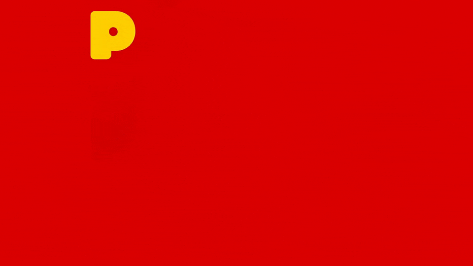

<p align="center">
  
</p>

<h1 align="center">POiO</h1>

<p align="center">
  A chicken-first kitchen companion. Pantry-aware, season-aware.
</p>

<p align="center">
  <a href="LICENSE"></a>
  <a href="LICENSE"></a>
  <a href="LICENSE"></a>
</p>

---

> **Heads up:** an early idea, lightly tested in exactly one kitchen by exactly one cook (me). Treat it as a sketch, not a product.

## What is POiO?

I fucking love chicken.

So I made POiO. Three little markdown files (the stuff in your kitchen, what's growing where you live, a flavor cheat sheet) and an assistant that reads them and has opinions. It looks at what you have and suggests what to cook. Chicken by default; other dishes when you ask for them, when there's no chicken in the house, or when your habits call for it.

Today it lives as a Claude Code skill. Next is an online mockup, then a chicken-shaped countertop device. Roadmap below; what's in each version is in [`SCOPE.md`](SCOPE.md).

## The bet

POiO is partly a kitchen toy and partly a bet on where things are going.

The bet: AI becomes a part you buy once, baked into an object the way a motor is baked into a blender. You don't rent it, it doesn't depend on someone else's servers, and it doesn't die when a company sunsets them.

That future isn't quite here. Build POiO with fully on-device intelligence *today* and it'd be too slow, too expensive, not smart enough — maybe all three. But the hardware that makes it cheap, fast, and smart enough is coming. It has to: the whole industry needs those parts to exist, so the market will drag them into being. The only real question is when, and nobody knows.

So POiO is a stab at imagining a product that the future will fully enable — and pointing at it now. It doesn't need the endgame hardware to be useful (each phase below is real and buildable with what exists). V1 and the online mockup use a hosted brain as a stepping stone; the endgame is the brain on the device. The cuteness is bait. The argument is that small, single-purpose AI appliances should belong to the people who buy them.

Being narrow helps: POiO doesn't need a general model, just a chicken-first kitchen companion. A tiny model that's *only* good at "suggest a dish from these six things and walk me through it" gets good enough years before the everything-machine does.

## Roadmap

Four named phases. Phases say *where* POiO runs; [`SCOPE.md`](SCOPE.md) says *what* it does in V1, V2 and later.

### 1. Skill *(works today)*

Lives in `~/.claude/skills/poio` as a symlink to this repo. Type `/poio` in a Claude Code session, or just start talking about food. It reads your pantry, your regional context and a flavor reference, then gives you three options, walks you through a recipe with checkpoints, or builds you a shopping list.

[`SKILL.md`](SKILL.md) is the base brain: the mockup, the app and the device all start from its logic.

### 2. Online mockup *(next)*

A hosted web app: Google login, the Anthropic API behind it, text-first, with voice input. It emulates the device's color e-paper screen and A/B-tests images + animation against text. Code will live in this repo under `mockup/`.

### 3. Device

Chicken-shaped (size and proportions per [`hardware/POiO.3dm`](hardware/POiO.3dm)), always-on, on the counter. A color e-paper screen (the leading option; panel TBD after a bench test), and under it a red star knob (turn, press, hold to talk) between two small pills. It answers with text and a few sounds, never speech. V1 is a thin client to the hosted brain.

See [`hardware/PLAN.md`](hardware/PLAN.md) for the product direction, [`hardware/UI-LANGUAGE.md`](hardware/UI-LANGUAGE.md) for the screen's design language, and [`hardware/PROTOTYPE.md`](hardware/PROTOTYPE.md) for the bench-test plan.

### 4. On-device brain *(the endgame)*

Same chicken, same personality, but the intelligence lives *inside* it. No server, no key, no network round-trip — a small model running on a chip inside the shell. Ask it what to make and it just answers.

This is the phase that explains the whole project. It's also the one that doesn't fully exist yet: the hardware to do it well and cheaply is still on its way. POiO doesn't wait for it. The earlier phases keep the brain *swappable*, so the day the right part lands it's a board swap, not a redesign.

The earlier local Python prototype is archived in [`archive/stage2/`](archive/stage2/).

## Architecture

The same shape in every phase:

```
┌─────────────────────────────────────────────┐
│  CLIENTS  (thin, swappable)                 │
│  • Claude Code skill (SKILL.md)             │
│  • Online mockup                            │
│  • Countertop device                        │
└──────────────────┬──────────────────────────┘
                   │ HTTP / JSON
                   ▼
┌─────────────────────────────────────────────┐
│  BRAIN                                      │
│  • SKILL.md logic + the Anthropic API       │
│  • Hosted for the mockup and V1             │
│  • On the device later                      │
└──────────────────┬──────────────────────────┘
                   │
                   ▼
┌─────────────────────────────────────────────┐
│  DATA                                       │
│  • Pantry                                   │
│  • Poionotas (what POiO knows about you)    │
│  • Recipes (schema in reference/)           │
└─────────────────────────────────────────────┘
```

In the skill, Claude Code plays both client and brain, reading the markdown files directly. From the mockup on, clients only talk to the brain over HTTP. The recipe schema and pantry model the mockup starts from are in [`reference/`](reference/).

Keeping the brain behind a clean HTTP boundary is the engine-boundary idea that makes the endgame a swap rather than a rewrite: the brain is whatever answers at that boundary. For now it's hosted; the endgame moves that same role onto a chip inside the device. The clients and the data don't care which.

## Quickstart (skill)

You need Claude Code installed.

```bash
# 1. Clone somewhere you don't mind keeping it long-term
git clone https://github.com/JaimeOrtegaxyz/POiO.git ~/Documents/GitHub/poio

# 2. Symlink it into your Claude skills directory
ln -s ~/Documents/GitHub/poio ~/.claude/skills/poio

# 3. Start a Claude Code session anywhere, then:
/poio
```

First use asks four quick questions (your city, how many you cook for, what you don't eat, what you have today). Each one is skippable, and then you get three options right away. The rest comes up gradually after your first cook, or all at once if you say "pregúntame todo". Your answers go into `pantry.md`, `references/regional-context.md`, `references/equipment.md` and `poionotas.md`. All four are gitignored. They're yours, they stay local.

Output defaults to Mexican Spanish and follows you into English if you write in English.

After that, just talk to it:

- *"¿Qué hago de cenar con lo que tengo?"*
- *"I'm going to the store."*
- *"Make me a chipotle-lime chicken bowl."*
- *"No hay pollo. ¿Qué hago con unos camarones?"*
- *"Compré poblanos y media crema."*

## Repository layout

```
poio/
├── SKILL.md                              # The base brain: persona, modes, output format
├── SCOPE.md                              # What's in V1 / V2 / Future / Discarded (canonical)
├── DECISIONS.md                          # Dated product decisions
├── VOICE.md                              # Voice, Spanish copy conventions, sound set
├── JOURNAL.md                            # Build log — the reasoning behind decisions
├── pantry.example.md                     # Pantry template
├── references/
│   ├── regional-context.example.md       # Worked example (Guadalajara / Western Mexico)
│   ├── equipment.example.md              # Equipment template
│   └── style-guide.md                    # Flavor families, sauces, assembly patterns
├── setup/
│   └── interview.md                      # Onboarding script (reused by mockup and device)
├── reference/                            # Recipe schema, pantry model, sample recipes
├── hardware/
│   ├── PLAN.md                           # Device product direction
│   ├── UI-LANGUAGE.md                    # The screen's design language
│   ├── PROTOTYPE.md                      # Color e-paper bench-test plan
│   └── POiO.3dm                          # Rhino shell model (WIP)
├── mockup/                               # Online mockup (first local build)
├── archive/                              # Earlier work, frozen (Stage 2 app, mockups, mono rig)
├── assets/                               # Logo, animation, journal images
├── LICENSES/                             # Full license texts (Apache-2.0, CERN-OHL-S, CC-BY-SA)
└── LICENSE                               # Which license covers what
```

Personal files (`pantry.md`, `references/regional-context.md`, `references/equipment.md`, `poionotas.md`) are generated on first use and never committed.

## Credits

Made by Jaime Ortega.

Angie Arias — product & UX collaborator

## License

Open, and share-alike so it stays open. Three licenses, one per kind of material:

- **Software** (skill, engine, firmware) — [Apache-2.0](LICENSES/Apache-2.0.txt)
- **Hardware** (Rhino model, schematics, PCB, meshes, BOM) — [CERN-OHL-S-2.0](LICENSES/CERN-OHL-S-2.0.txt)
- **Content** (docs, recipe data, style guide, assets) — [CC-BY-SA-4.0](LICENSES/CC-BY-SA-4.0.txt)

All three are share-alike: use it, modify it, sell it — but keep derivatives open under the same license and credit the original. The POiO name and logo are not licensed for uses implying endorsement. See [`LICENSE`](LICENSE) for the full rundown.
